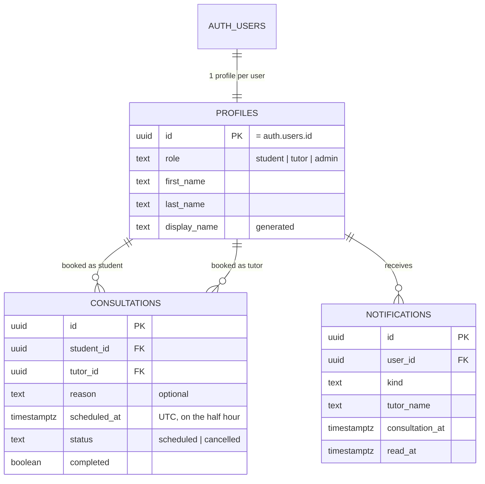

# Consultation booking: Contour Education technical assessment

A small learning-management app. **Students** sign up, book a consultation with a **tutor** at a free
time, tick it off once it has happened, and reschedule or cancel it. **Tutors** see the consultations
booked with them. **Admins** see every consultation (read-only) and decide who is a tutor.

**Stack:** Next.js 16 (App Router) · TypeScript · Supabase (PostgreSQL, Auth, Row Level Security) via
`supabase-js` + `@supabase/ssr` · Tailwind + shadcn/ui (Radix) · Zod · Vitest · Playwright · pgTAP.

## Setup

Prerequisites: **Node 20+** (built on 22), **Docker** running, and a recent
[Supabase CLI](https://supabase.com/docs/guides/local-development) (built and tested with 2.117;
`npm run env:local` reads the publishable key from `supabase status -o env`, which needs a 2.x
release that reports `PUBLISHABLE_KEY`).

```bash
npm install
supabase start        # local Postgres + Auth; applies supabase/migrations and supabase/seed.sql
npm run env:local     # writes .env.local (URL + publishable key only) from `supabase status`
npm run dev           # http://localhost:3000
```

1. **`npm install`** installs the dependencies (no other global tools are needed except the Supabase CLI).
2. **`supabase start`** pulls and starts the local stack in Docker; the first run downloads the images and
   takes a few minutes. It applies every file in `supabase/migrations/` and then `supabase/seed.sql`, and
   prints the local URLs: API `http://127.0.0.1:54321`, Studio `http://127.0.0.1:54323`, Mailpit
   `http://127.0.0.1:54324`. Ports 54321 to 54324 and 3000 must be free.
3. **`npm run env:local`** creates `.env.local`. It holds only the local API URL and the publishable key
   (safe to expose to a browser, and protected by RLS). The app never uses a secret or service-role key; only
   the test helpers do, to create fixture users, and they read it from `supabase status` when they run.
4. **`npm run dev`** serves the app at http://localhost:3000. For a production build instead:
   `npm run build && npm start`.

`supabase db reset` rebuilds the database from the migrations and seed at any time (and deletes
everything you created, including accounts). `supabase stop` shuts the stack down.

If something does not start: `docker ps` must work (Docker Desktop running); `supabase status` shows whether
the stack is up; if `npm run env:local` fails, update the Supabase CLI (it needs 2.x with
`PUBLISHABLE_KEY` in `supabase status -o env`).

**Try it with the seeded accounts** (local development only):

| Role    | Name         | Email                  | Password               |
| ------- | ------------ | ---------------------- | ---------------------- |
| Admin   | Alex Morgan  | `admin@example.com`    | `admin-password-123`   |
| Tutor   | Maya Chen    | `tutor1@example.com`   | `tutor-password-123`   |
| Tutor   | Jordan Reyes | `tutor2@example.com`   | `tutor-password-123`   |
| Student | Sam Taylor   | `student@example.com`  | `student-password-123` |
| Student | Priya Nair   | `student2@example.com` | `student-password-123` |
| Student | Liam Walsh   | `student3@example.com` | `student-password-123` |

Anyone who signs up is a **student** (sign-up asks for first and last name). Email confirmation is off in
the local config, so sign-up logs you straight in. Passwords need 8+ characters with letters and digits.
Local Supabase sends no real email: password-reset messages land in its inbox at http://127.0.0.1:54324
(Mailpit).

A quick tour: as **Sam**, book Maya at a free time (the slot grid crosses out taken times); as the
**admin**, open *People* and switch Jordan off (the app asks whether to cancel his upcoming consultations
and notify the students, or keep them), then sign in as Sam to see the notice.

**Scenarios to walk through** (each is also an automated test; the last column says which):

| # | As | Do this | Expect | Test |
| - | -- | ------- | ------ | ---- |
| 1 | Nobody | Open `/dashboard` | Redirected to the login page | `auth.spec.ts` |
| 2 | New student | Sign up with a name | Lands on the dashboard with an empty list | `auth.spec.ts` |
| 3 | Student | Pick Maya, a weekday, a time; book | "Consultation booked."; the time is now crossed out; the card is under Upcoming with the *Completed* tick disabled until it starts | `student-journey.spec.ts` |
| 4 | Student | Reschedule, then cancel (confirm) | New time shown; then "Cancelled" with the buttons gone | `student-journey.spec.ts` |
| 5 | Two students | Book the same tutor and time | One wins; the other is told and sees the time taken | `student-journey.spec.ts` |
| 6 | Student | Open `/admin` | Sent back to the dashboard; the admin APIs answer 403 | `roles.spec.ts` |
| 7 | Admin | Open the consultations list | Every consultation, read-only, filterable, sortable, paged | `roles.spec.ts` |
| 8 | Admin | *People*: search, switch a student to tutor | Role becomes Tutor; they now appear in the tutor list | `roles.spec.ts` |
| 9 | Admin | Switch off a tutor with upcoming consultations | Asked to cancel (students are notified) or keep | `roles.spec.ts` |
| 10 | Tutor | Sign in | Lands on *Sessions with me*; no admin access | `roles.spec.ts` |

### Using a hosted Supabase project

The app only needs the project URL and publishable key in `.env.local` (see `.env.example`).

1. `supabase link --project-ref <ref>` then `supabase db push` applies the migrations.
2. **Do not run `supabase/seed.sql`** (local demo accounts, with public passwords) and do not
   `supabase config push` the local `config.toml` as it is: it turns email confirmation off and points
   the site URL at localhost. Turn confirmation on, set the site URL and add your origin to the redirect
   allow-list in the dashboard. With confirmation on, sign-up sends people to a "check your email" page.
3. **Create the first admin** with one statement, after that person has signed up:
   `update public.profiles set role = 'admin' where id = (select id from auth.users where email = '…');`
   Admins can only be made in SQL; nothing in the app can grant the role. Tutors are made from the
   People screen by an admin.

The full pre-deployment checklist is in [docs/security.md](docs/security.md).

### Running the tests

The integration, API and browser tests talk to the local Supabase stack, so `supabase start` must be
running (and `npm run env:local` run once) before `npm test`. The tests create their own users and
bookings in the same local database and leave them behind, which also fills the demo data with test
users: run `supabase db reset` before showing the app.

```bash
npx playwright install chromium firefox webkit   # once, for the browser tests
npm test                                         # everything below, in order
```

| Command | Layer | What it proves |
| --- | --- | --- |
| `npm run test:db` | pgTAP (159 assertions) | Grants, RLS, constraints, the rule triggers (slots, notice, tutor, completed-only-after-start), the sign-up trigger, the People and notification functions, including every negative case |
| `npm run test:unit` | Vitest unit + UI (392) | Schemas, pure business rules, the Melbourne slot and date maths (incl. both DST edges), the list-query parser, every screen's behaviour against a mock API |
| `npm run test:integration` | Vitest vs the real database (47) | The service layer under real RLS; attacks sent straight at Supabase's REST API |
| `npm run test:api` | Playwright HTTP (146) | Every route: status codes, error codes, ownership, role checks, and one table-driven suite that holds every list endpoint to the same query convention |
| `npm run test:e2e` | Playwright browser, Chromium (53) | Journeys for each role, two students racing for one slot, demotion and notifications, isolation, session expiry, layout at phone width, accessibility (axe) |
| `npm run test:browsers` | The same journeys in Firefox (43) and WebKit (53); the 10 axe scans are skipped in Firefox, where they crash its page process | Cross-engine behaviour |

Also: `npm run lint`, `npm run typecheck`, `npm run build`. Requirements are numbered in
[docs/acceptance-criteria.md](docs/acceptance-criteria.md); [docs/traceability.md](docs/traceability.md) maps
each to the tests that prove it.

## What is implemented

| From the brief | Where |
| --- | --- |
| Authentication (login / logout / sign up) | Starter auth pages (plus forgot/reset password); sign-up asks for a name; each role lands on its own screen |
| Student dashboard listing the student's consultations | `/dashboard`: cards grouped Upcoming and Earlier, with search, sort, filters and paging |
| Mark individual consultations complete / incomplete | The *Completed* tick on each card, available once the consultation has started |
| Booking form that creates a consultation | Top of `/dashboard`: tutor, day, time, optional reason (see "Where this departs from the brief") |
| Reschedule and cancel (own consultations) | Per-card dialogs; reschedule keeps the tutor; cancel asks for confirmation |
| Admin view of all consultations, read-only; "define roles" | `/admin` (all consultations) and `/admin/people`; three roles, below |
| Prefer APIs over Server Actions | All data goes through Route Handlers (`app/api/**`); a guard test fails if a Server Action appears |
| Migrations and schema | `supabase/migrations/` and `supabase/schema.sql` (below) |

Beyond the brief: tutors as bookable people with a "Sessions with me" view, an admin People screen to make
and unmake tutors, in-app notifications, double-booking protection, and server-side data tables.

### Where this departs from the brief

The brief's booking form has **first name, last name, reason and datetime**. This app asks for **a tutor, a
day and time, and an optional reason**. I did that on purpose, and flag it so it is not read as an omission:

- **First and last name** are asked once, at sign-up, and stored as the person's display name. Asking a
  signed-in student to retype who they are on every booking is redundant and invites mistakes; a tutor or
  admin needs the *account's* name, not whatever was typed.
- **A booking needs two parties.** The brief says only students and an admin exist; a consultation with nobody
  to consult is not much of a booking, so the person being booked is a role of their own (tutor), and the
  admin manages who that is. The brief also says implementation details are non-exhaustive and to make
  assumptions; all of them are listed below.
- **The datetime is picked, not typed.** The student chooses a day, then one of the tutor's free half-hour
  slots, so nothing can be mistyped and two students cannot book the same tutor at the same time.
- **The reason is optional**, free text only, and a consultation without one shows "No reason given".
- **Complete can only be ticked once the consultation has started.** "Complete" means it happened, so a future
  consultation cannot be marked complete (the UI, the API and the database all refuse). Unticking is always
  allowed.

## API

Every list endpoint takes the same query (see [A23](docs/decisions/0007-roles-tutors-and-notifications.md)):
`page[number]`, `page[size]`, `sort=-field,field`, `filter[field]` (with `[eq|in|gte|lte]`), `filter[q]` for
search. It answers `{ data, meta: { page: { number, size, total, total_pages } } }`. An unknown or
malformed parameter is a `400` that lists what is allowed.

| Method and path | Purpose | Who |
| --- | --- | --- |
| `GET /api/consultations` | The caller's own consultations | student |
| `POST /api/consultations` | Book (`tutor_id`, `scheduled_at`, optional `reason`) | student |
| `PATCH /api/consultations/:id` | `reschedule`, `set_completed` or `cancel` | the owning student |
| `GET /api/tutor/sessions` | Consultations booked with the caller as the tutor | anyone (rows are the caller's) |
| `GET /api/admin/consultations` | Every consultation, read-only | admin |
| `GET /api/admin/people` | Everyone, with email; search by name or email | admin |
| `PATCH /api/admin/people/:id` | Make or unmake a tutor (`cancel_upcoming` when they have upcoming) | admin |
| `GET /api/notifications`, `PATCH /api/notifications/:id` | The caller's notices; dismiss one | signed in |
| `GET /api/tutors`, `GET /api/tutors/:id/busy` | The booking picker; a tutor's taken times | signed in |

## How roles work (and why)

RBAC uses **Postgres Row Level Security** with a `profiles.role` column (`student`, `tutor` or `admin`; one
per person). What each role may do is a short table of capabilities, defined once in
[`lib/domain/roles.ts`](lib/domain/roles.ts) and mirrored by database functions:

| Role | `write` (book and manage own consultations) | `readAll` (every consultation) | `manageTutors` |
| --- | --- | --- | --- |
| `student` | yes | no | no |
| `tutor` | no (sees what is booked with them) | no | no |
| `admin` | no (read-only) | yes | yes |
| no role (no profile row) | no | no | no |

Access is granted by the table, never by default: a missing or unknown role can do nothing, and adding a
role is a compile error until its capabilities are decided. The rules are enforced in five independent places,
so any one failing does not leak data:

1. **Grants** decide which database roles can touch a table at all (nothing for `anon`; students can only
   update three columns; nobody can delete).
2. **RLS policies** decide which rows: your own; a tutor's consultations booked with them; admins read all.
   Writes require `private.can_write()` (students only); there is no admin or tutor write policy. Emails live
   in `auth.users`, which only admin-only database functions can read.
3. **Triggers and constraints** enforce the rules a signed-in user could otherwise skip by calling Supabase's
   REST API directly: the half-hour slot grid, weekday business hours in Melbourne, at least an hour's notice and
   at most eight weeks, the tutor must be a tutor, cancelled is terminal, a started consultation cannot be moved
   or cancelled, and Completed only after it starts. **Unique indexes** make a double booking impossible, however
   many people click at once.
4. **The API and service layer** authenticate (`getUser()`), validate, check the capability with `can(role, ...)`
   (403) and ownership (404), and turn database errors into clear answers (409 "that time was just taken").
5. **The UI** only reflects the role; it is a convenience, not the boundary.

A role can only be changed by an admin through a database function that refuses to touch another admin, and an
admin can only be created in SQL or the seed. Why not a custom-claims auth hook? A role in the JWT goes stale
until the token refreshes, which is the wrong trade for a security role. Reasoning and trade-offs are in
[ADR 0001](docs/decisions/0001-rbac-profiles-role-and-rls.md) and
[ADR 0007](docs/decisions/0007-roles-tutors-and-notifications.md).

## Assumptions

The brief is deliberately non-exhaustive and asks for assumptions to be stated. These are mine (the full register,
with the reasoning, is in [ADR 0007](docs/decisions/0007-roles-tutors-and-notifications.md)):

**People and roles**
- Three roles, one per person. Everyone who signs up is a student; admins exist only through the seed or one SQL
  line; an admin makes and unmakes tutors. There is no super admin: the admin is the brief's read-only role.
- Admins are read-only on consultations. A tutor sees every consultation booked with them (view only), including
  after they stop being a tutor, in "Sessions with me". A student sees a tutor's display name and nothing else.
- Turning off a tutor who has upcoming consultations asks the admin to **cancel them and notify the students**, or
  **keep them**. Nothing happens until the admin chooses.

**Booking**
- Slots are 30 minutes, 9:00 to 16:30 starts, Monday to Friday, the same for every tutor, in **one fixed zone
  (Australia/Melbourne)**, shown on every time with its AEDT/AEST label and not editable.
- At least an hour from now and at most eight weeks ahead. A tutor has one scheduled consultation per slot; a
  student cannot hold two at the same time; cancelling frees the slot. Reschedule keeps the tutor.
- **Public holidays are not modelled**: any weekday in hours can be booked. Tutors setting their own availability
  (or a holiday calendar) would fix that.
- The reason is optional free text. A consultation that has started can no longer be moved or cancelled; it can be
  ticked complete. Cancel is soft and terminal (the record stays for the admin's "all consultations").

**Lists and display**
- Every table is a server-side data table (search, sort, filters, paging) with its state in the URL, and every list
  endpoint shares one query convention. A student's own list stays as cards.
- Upcoming vs Earlier is by date and time alone. A card's look (today, upcoming, complete, started but not marked
  complete, cancelled) comes from one rule, and Status sorts and filters by exactly those four words.
- Notifications are in-app only, shown until dismissed, and never repeat the (possibly long) reason. Tutors are not
  notified of bookings; they see them in their list.
- Times are stored as UTC instants. No CSV export.

## Implementation summary

```
app/api/…            thin route handlers: parse (Zod), call one service method, return JSON
lib/api/             handler (auth, error shape, no-store), list-query (the one parser for every list)
lib/services/        business logic; one Supabase client already scoped to the user, one role lookup per request
lib/domain/          pure rules: roles, slots (Melbourne), consultation state; no I/O, easy to test
lib/schemas/         Zod schemas shared by the browser and the server
lib/hooks, lib/list-state   URL-backed list state; the browser's typed API client is lib/api/client.ts
components/          shadcn/ui primitives, the shared data-list pieces, and feature views
supabase/            migrations, schema.sql snapshot, seed, pgTAP tests
tests/               unit, ui, integration, api, e2e
docs/                acceptance criteria, architecture, ADRs, conventions, security
```

**Choices worth knowing about**

- **Route Handlers, no Server Actions.** The browser talks to `/api/*`, which authenticates with `getUser()` and
  answers in one error shape. The Next 16 settings `cacheComponents` and `partialPrefetching` are on because the
  pages are shells around per-user data: handlers call `connection()` so they are never prerendered or cached,
  and responses are `private, no-store`.
- **The database is the source of truth for the rules**, the API gives the friendly errors. A double booking is
  settled by a partial unique index, so two simultaneous requests cannot both win; the loser gets a 409.
- **One list mechanism.** Each list declares its allowed sort fields, filters and search columns once; a shared
  parser validates the query (unknown fields are a 400, nothing client-sent is ever a column name) and a shared
  builder applies it. Counts are exact for every list except the admin's, which is an estimate once large.
- **Scales without changing shape.** Everything is paged in the database with an index per list order, the
  tutor picker searches on the server and fetches a page of matches, and slot availability is a small query per
  tutor per day. Offset paging is fine at this size; a keyset cursor is the next step (the response shape already
  has room for one).
- **The session is re-validated, not just decoded.** Each API request makes one round trip to Supabase Auth
  (`getUser()`) and reads the role once per request ([ADR 0003](docs/decisions/0003-server-auth-in-route-handlers.md)).
  The cheaper design is a custom access-token hook that puts the role in the JWT, at the cost of a role change
  waiting for the token to refresh; it is the first thing I would change under load.
- **Standard components.** shadcn/ui (Radix) for dialogs, selects, popover, switch and checkbox; the only custom
  piece is the tutor combobox, built on the standard Popover with the ARIA combobox pattern.

The app is built **test-first** where it matters (rules, parsers, state machines), with the requirements written as
numbered acceptance criteria and the main decisions recorded as ADRs.

## Schema and migrations



| Migration | Contents |
| --- | --- |
| `20261113100000_profiles_and_roles.sql` | `profiles` (three roles, names), the sign-up trigger (always `student`), `private.is_admin()` and `private.can_write()`, grants |
| `20261113100100_consultations.sql` | `consultations` with the tutor and the half-hour grid, the two unique indexes that prevent double booking, `tutor_busy_times()`, RLS, the `consultation_details` view |
| `20261113100200_consultation_state_rules.sql` | The rule trigger (slots, notice, tutor, state, completed-after-start), column-level grants, stricter insert policy |
| `20261113100300_people_and_notifications.sql` | `notifications`, the admin-only `admin_list_people()` and `admin_set_tutor()` (promote, demote, cancel-and-notify) |
| `20261115000000_consultation_state.sql` | The `state` column on the view (cancelled, complete, awaiting, scheduled) that lists sort and filter by |

The migrations are the source of truth. [`supabase/schema.sql`](supabase/schema.sql) is a readable snapshot of the
resulting `public` and `private` schemas, regenerated with `npm run db:schema`.

More detail: [docs/architecture.md](docs/architecture.md) (diagrams, API contract, access matrix),
[docs/conventions.md](docs/conventions.md), [docs/security.md](docs/security.md).

## What I would do next

- **Tutors set their own availability** (and a holiday calendar), replacing the shared weekday slots.
- **Email notifications** on booking and cancellation, reading from the same `notifications` table.
- **CSV export** of the admin tables.
- The **role in the JWT** through an access-token hook (fewer round trips per request), and the first page of each
  list rendered on the server instead of fetched after hydration.
- A **keyset cursor** on `(scheduled_at, id)` for the biggest lists; a trigram index and an email copy on profiles
  for fast email search at very large scale (today it is an unindexed `ILIKE` inside an admin-only function).
- Rate limiting and a script-restricting, nonce-based Content-Security-Policy (the framing, base-URI, form-target
  and plugin directives are already set).
- Run the pgTAP, integration and browser suites in CI against `supabase start`, against a database separate from
  the demo data.

## Traceability

Every numbered requirement in [docs/acceptance-criteria.md](docs/acceptance-criteria.md) is mapped to the tests that
prove it in [docs/traceability.md](docs/traceability.md).
