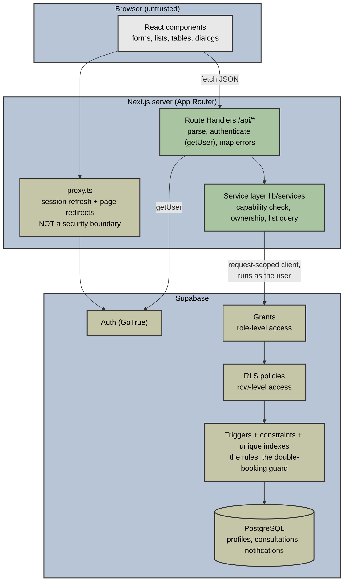
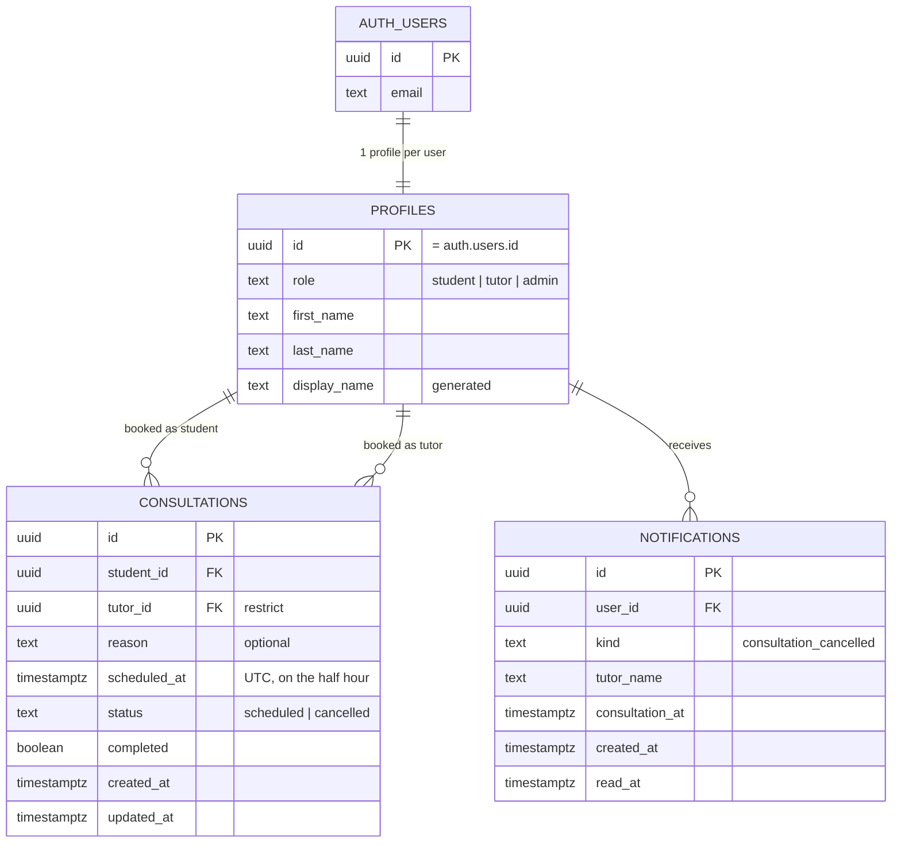
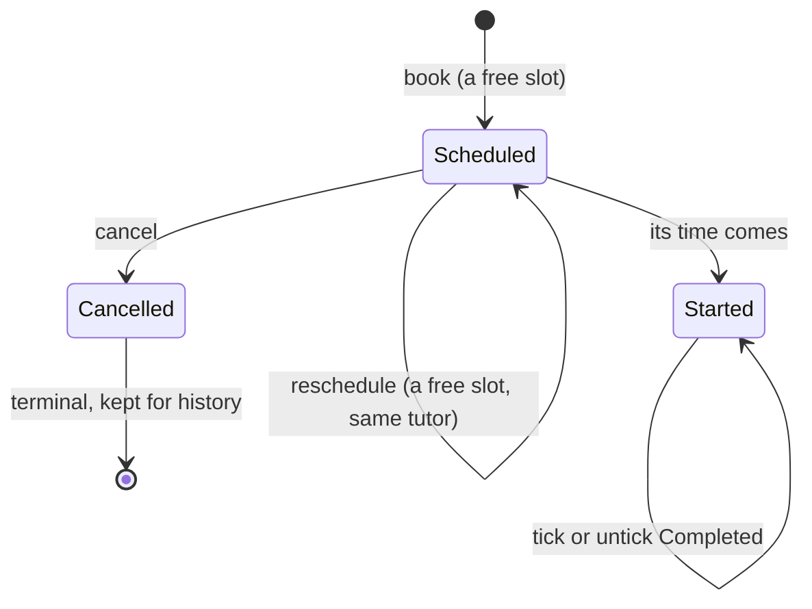
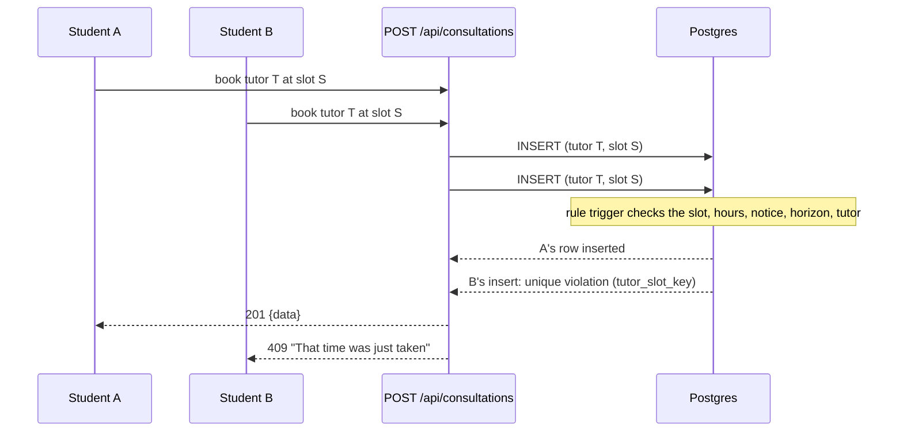

# Architecture

Technical design for the consultation-booking app. Business-level behaviour and setup live in the
README; this file explains how it is built and why. Requirement ids (AC-n) refer to
[acceptance-criteria.md](acceptance-criteria.md); decisions to [decisions/](decisions/), above all
[ADR 0007](decisions/0007-roles-tutors-and-notifications.md) (the tutor model and the assumptions register).

## 1. Layers and trust boundaries

Authorization is enforced in several independent places. Any one of them failing should not leak data.



| Layer | Responsibility | Must not |
| --- | --- | --- |
| Route Handler | Parse and validate input (Zod, and the shared list parser), authenticate (`getUser`), call one service function, map errors to the response shape | Contain business rules or build queries |
| Service (`lib/services`) | The capability check (`can(role, …)`, 403), ownership (404), queries through the request-scoped client, translating database errors (409, 400) | Know about HTTP, cookies or `Request` |
| Database | Grants, RLS, the rule triggers, constraints and unique indexes: the final authority | Trust the caller |

No repository layer: one database, the Supabase client is already the data-access abstraction, and the
services are tested against the real local database. One `createServices(db, userId)` per request builds every
service around a single shared `access` object, so the caller's role is looked up at most once.

The service-role key is never used by the app at runtime (ADR 0002, 0003); it appears only in the test fixtures.

## 2. Data model



`public.consultation_details` is a `security_invoker` view that adds the tutor's and student's display names
and a `state` (cancelled, complete, awaiting, scheduled) worked out in the database. Because it runs with the
caller's rights, every policy applies to it: a student gets their rows, a tutor theirs, an admin everything.

Indexes (each matches a real query; AC-18):

- `consultations (student_id, scheduled_at, id)`: a student's list.
- `consultations (tutor_id, scheduled_at, id)`: a tutor's list.
- `consultations (scheduled_at, id)`: the admin list, either direction.
- Partial unique `(tutor_id, scheduled_at) where status = 'scheduled'` and `(student_id, scheduled_at)`:
  one scheduled consultation per tutor per slot, and one per student at a time. These **are** the double-booking
  guard.
- A trigram index on `profiles.display_name` for name search.

## 3. Consultation lifecycle (AC-3, AC-5, AC-6, AC-27, AC-28, AC-29, AC-33)



- Before it starts: it can be moved or cancelled, and **cannot** be marked complete.
- Once it has started: it can no longer be moved or cancelled; Completed can be ticked and unticked.
- Cancelled is terminal: any change returns `409 CONFLICT`.

The same rules are in three places: the trigger `private.enforce_consultation_rules()` (the authority), the
service (friendly 409 and 404 answers), and the pure functions in `lib/domain/consultation-rules.ts`
(`canChange`, `canComplete`, `consultationTone`), which also drive the `can_edit` and `can_complete` flags the UI
reads. Which group a card is in (Upcoming or Earlier) depends on time alone; how it looks depends on one tone
function, and Status sorts and filters by the database's `state`, which has the same four words as the badge.

## 4. Access matrix (AC-8 to AC-13, AC-30 to AC-36)

| Action | Anonymous | Student (own row) | Student (other's row) | Tutor | Admin |
| --- | --- | --- | --- | --- | --- |
| List own consultations | 401 | own only | invisible | none (not a student) | none |
| Book a consultation | 401 | yes, with a tutor, as self | n/a | 403 | 403 |
| Reschedule / complete / cancel | 401 | yes, under the rules | 404 (existence not revealed) | 403 | 403 |
| List consultations booked with me | 401 | empty | n/a | yes (also after being demoted), view only | empty |
| Read every consultation | 401 | 403 | n/a | 403 | yes, read-only |
| List people (with email), make or unmake a tutor | 401 | 403 | n/a | 403 | yes; never another admin |
| Read or dismiss own notifications | 401 | yes | invisible | yes | yes |

Writing consultations is a student capability, enforced in the insert and update policies, the service (403) and
the UI. The admin's one write is `admin_set_tutor()`, a database function that refuses anyone but an admin and
refuses to touch an admin. A role is never set from client input. Each row is enforced at the grant, policy,
service and route layers and covered by a pgTAP or API test.

## 5. Booking: the race the database decides



The browser shows availability from `GET /api/tutors/:id/busy` (only the taken instants, nothing about who or why),
but that is a convenience: the unique index decides. The loser's form refreshes the availability and shows the
message.

## 6. API contract

All bodies are JSON. Field names are snake_case on the wire and in the database (one naming convention end to
end; no mapping layer). Full table in the README; error body, always:
`{ "error": { "code": "VALIDATION_ERROR | UNAUTHENTICATED | FORBIDDEN | NOT_FOUND | CONFLICT | UNSUPPORTED_MEDIA_TYPE | INTERNAL", "message": "...", "details"?: ... } }`.
Internal errors return a generic message; details are logged server-side only.

**One list convention** (ADR 0007, A22, A23). Every list endpoint takes `page[number]`, `page[size]` (max 100),
`sort=-field,field` (at most three), `filter[field]` with `eq`, `in`, `gte` or `lte` where the field allows it, and
`filter[q]` for search, and answers `{ data, meta: { page: { number, size, total, total_pages } } }`. Each
endpoint declares its allowed sorts, filters and search columns once (a `ListSpec` in its service); a single
parser (`lib/api/list-query.ts`) validates the query against it and a single builder applies it. Anything not
declared, repeated or malformed is a `400` that lists what is allowed. Search text has wildcard and control
characters turned to spaces, and no client-sent text is ever used as a column name or part of a query expression.

The tables keep their state in the URL (`lib/list-state.ts`, `lib/hooks/use-list-state.ts`), so a refresh, the back
button and a shared link keep the view. Paging is offset-based with an exact count (an estimate for the admin's
consultations); the response shape already leaves room for a keyset cursor.

List items carry `can_edit` and `can_complete`: true only where the viewer is the owning student and the rules allow
the change. The tables render no controls whatever the flags say. This is the read-path twin of the mutation guard,
so the UI never has to guess.

## 7. Time

Times are UTC instants everywhere except what a person reads. Bookings live in one fixed zone,
Australia/Melbourne (ADR 0007, A12): `lib/domain/slots.ts` builds a day's sixteen slots from Melbourne wall-clock
time with `Intl` (so the daylight-saving change is handled), `lib/dates.ts` words every time with the AEDT/AEST
label, and the database checks weekday and hours in the same zone. Nothing depends on the viewer's own zone.

## 8. Module layout

```
app/
  auth/...                              starter auth pages (login, sign-up, reset, confirm, error)
  dashboard/, sessions/, admin/, admin/people/   one screen set per role (server-gated layouts: UX, not security)
  api/...                               route handlers (consultations, tutor/sessions, admin/*, notifications, tutors)
lib/
  supabase/{client,server,proxy}.ts
  services/{access,consultations,tutors,people,notifications,index}.ts   business rules and queries
  domain/{roles,slots,consultation-rules}.ts    roles, Melbourne slots, state rules and tone: pure
  api/{handler,http,client,list-query}.ts       server wrapper, response helpers, browser client, the list parser
  schemas/{api,consultation,people,notifications}.ts   Zod schemas shared by client and server
  hooks/, list-state.ts                 URL-backed list state, server list hook, action outcomes
  errors.ts, messages.ts, routes.ts, dates.ts
components/{ui,data-list,features}/      shadcn primitives, the shared table/pager/toolbar, feature views
types/database.ts                       generated by `supabase gen types`
supabase/{config.toml,migrations,tests/database,seed.sql,schema.sql}
tests/{unit,ui,integration,api,e2e,support}
docs/
```

## 9. Operational notes

- `proxy.ts` handles session refresh and redirects page loads; API routes authenticate themselves and answer 401 JSON.
- Authenticated routes are dynamic and never cached (ADR 0003).
- Local Supabase via `supabase start`; migrations and seed apply automatically; `supabase db reset` rebuilds.
- The tests share the local database with the demo data (ADR 0004); reset it before a demo.
